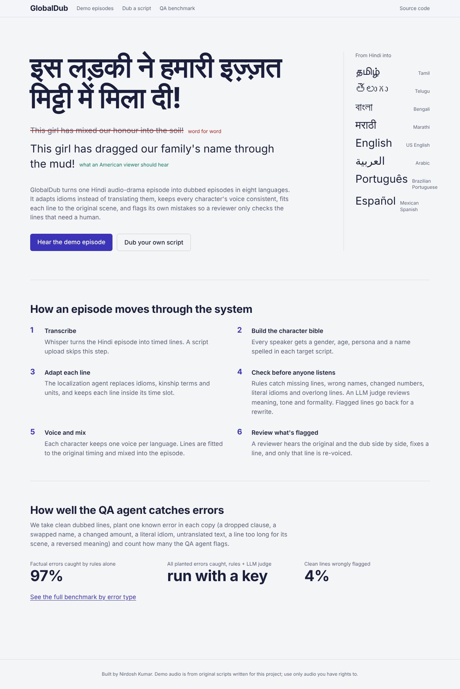
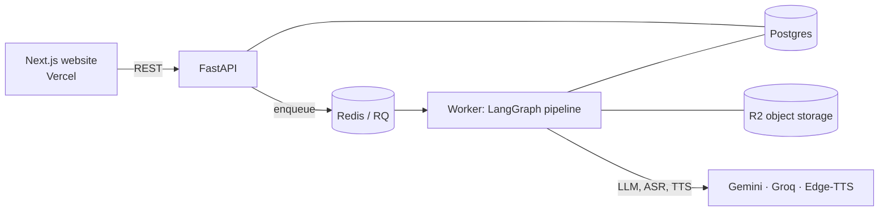
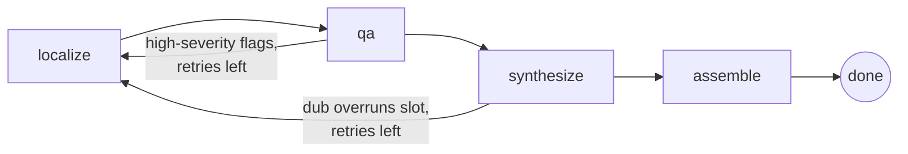

# GlobalDub AI

**Agentic dubbing and localization QA for Indian audio drama.** One Hindi episode in, dubbed episodes out in
Tamil, Telugu, Bengali, Marathi, US English, Arabic, Brazilian Portuguese and Mexican Spanish, with culturally
adapted dialogue, consistent character voices, timing fitted to the original scene, and a QA agent that flags its
own mistakes so a human reviews only the lines that need one.

**Live demo:** _add your Vercel URL here_ · **API docs:** _your-api-url_/docs



## The problem

Translating a Hindi drama is the easy part. Shipping it to another market means:

- **Idioms:** "इज़्ज़त मिट्टी में मिला दी", translated word for word, comes out as "mixed our honour into the soil".
- **Facts that silently break:** names get swapped, "पचास लाख" must become "5 million rupees" in English but stay "50 லட்சம்" in Tamil, lines get dropped.
- **Timing:** Tamil and Telugu lines often run longer than the Hindi, so the dub drifts out of sync with the scene.
- **Consistency:** the same character has to sound the same in every episode, in every language.
- **Review cost:** a human listening to every line in every language doesn't scale.

## What it does

| Stage | How |
|---|---|
| Transcribe | Groq Whisper API (deployed) or local faster-whisper + pyannote diarization. A script upload skips this stage. |
| Audio analysis | For audio uploads, pitch tracking gives each speaker's gender, splits one unlabeled voice into two speakers when pitches clearly differ, spots sung lines (held notes) and measures loudness and pace as delivery hints. |
| Character bible | LLM infers gender, age and persona, and writes each name in every target script (Meera → மீரா → ميرا). |
| Localize | Gemini (or any OpenAI-compatible model such as Qwen), driven by a **language pack** per market: register, honorifics, kinship terms, unit conversion, cultural notes and a per-line character budget. |
| QA | **Rules:** omission, untranslated or wrong-script text, Hindi words leaking into Marathi, character names, value-level numbers (lakh/crore aware), glossary, literal idioms, duration. **LLM judge:** meaning drift, tone, formality and gender agreement. **Audio check:** the real voiced duration against the time slot. |
| Self-correction | A LangGraph loop sends high-severity lines back to the localizer with the QA feedback (max 2 retries). Lines that are still too long after voicing go back too. |
| Voice | Edge neural voices (free) with Gemini TTS / ElevenLabs as fallbacks. Each character gets one pinned voice per language, and emotion maps to rate, pitch and volume. |
| Background | Keeps the music & effects (M&E) under the new dialogue: an uploaded background track, or one separated from the uploaded mix (Demucs locally; centre-channel cancellation on the small server). |
| Mix | Every line is placed on the original timeline (sped up by at most 1.25x to fit), matched to the original dialogue loudness, and mixed over the background with ducking while someone speaks. Outputs MP3 + SRT (RTL-safe for Arabic). |
| Review Studio | Original vs dub per line, back-translation for languages the reviewer doesn't speak, approve or edit. **Only the edited line is re-voiced** and re-mixed. Review time is logged. |





## QA benchmark

`backend/eval/planted_errors.py` takes clean dubbed lines, plants one known error per copy, and measures how many
the QA agent flags, plus how many clean lines it flags by mistake.

Rules only (offline, no API key), US English, sample episode:

| Planted error | Caught |
|---|---|
| Whole line dropped | 26/26 |
| Sentence or clause dropped | 25/26 |
| Character name swapped | 8/8 |
| Amount or count changed | 5/5 |
| Left in Hindi | 26/26 |
| Idiom translated literally | 3/3 |
| Too long for the scene | 26/26 |
| Meaning reversed | 0/6 |
| **Overall** | **94%** |
| **Clean lines wrongly flagged** | **0%** |

Rules are free and explainable but can't see meaning (0/6 reversed meanings). That gap is what the LLM judge is
for: run `python eval/planted_errors.py --langs en-US --judge` with a Gemini key to measure the full agent, and
`--from-episode` to benchmark Tamil, Arabic and the other languages on real pipeline output.

## Run it locally

Requirements: Python 3.11+, Node 20+, FFmpeg on PATH.

```bash
# backend
cd backend
python -m venv .venv && source .venv/bin/activate      # Windows: .venv\Scripts\activate
pip install -r requirements-dev.txt
cp ../.env.example .env                                  # add GEMINI_API_KEY and GROQ_API_KEY
pytest -q                                                # runs offline

# 1) pipeline from the command line
python scripts/run_local.py ../samples/virasat_ep01.json --langs en-US,ta-IN,ar-SA

# 2) the full app
uvicorn app.main:app --reload                            # http://localhost:8000/docs
cd ../frontend && npm install && npm run dev             # http://localhost:3000
```

Set `GD_LLM=mock GD_TTS=mock` to run everything offline with no keys. Mock mode is for testing the plumbing: it
echoes reference translations, and lines without one are flagged as untranslated.

Production-like stack with Postgres + Redis + a separate worker: `docker compose up --build`.

Deployment (Vercel + Render + Neon + Upstash + Cloudflare R2, all on free tiers): see [DEPLOY.md](DEPLOY.md).

## Background music and effects

Studios dub on top of an **M&E track** (everything except dialogue). GlobalDub does the same:

- **Background track uploaded** (script or audio): the dub is mixed over it; a short track is looped.
- **Audio uploaded without one:** the background is separated from the mix. Locally, `pip install demucs`
  enables Demucs (best quality, also gives a clean dialogue stem for transcription); on the 512 MB server,
  centre-channel cancellation works for stereo mixes. `python scripts/separate.py episode.mp3` makes the stems on
  your machine so you can upload the background with the episode.
- **Mixing:** dub lines are scaled to the original dialogue loudness, and the background dips by `GD_DUCK_DB`
  (default 6 dB) while someone speaks.

The demo episode's background score (`samples/virasat_bed.mp3`) is synthesized by `scripts/make_ambient_bed.py`,
so it is original and safe to publish.

## Adding a language

Add `backend/langpacks/<code>.yaml` with the script's Unicode range, speaking rate, register guide, cultural notes,
number words and voices. No code changes are needed: the localizer prompt, QA checks, voice casting and the website's
language picker all read from the pack.

## Project layout

```
backend/
  globaldub/        pipeline package: schemas, language packs, agents, providers, LangGraph orchestration
    agents/         glossary (character bible), localizer, qa, voice director
    providers/      llm (Gemini / OpenAI-compatible / mock), tts (Edge / Gemini / ElevenLabs / mock), asr
  app/              FastAPI API, SQLAlchemy models, RQ queue, lost-update-safe persistence, rate limits
  langpacks/        one YAML per language
  eval/             planted-error QA benchmark
  worker/           RQ worker entrypoint
frontend/           Next.js 16 + TypeScript + Tailwind 4
samples/            original Hindi micro-drama script used for the demo and the benchmark
```

## Engineering decisions

- **API and worker are separate.** Dubbing takes minutes, so the API only validates, stores and enqueues; an RQ
  worker does the work. Locally, without Redis, a thread pool stands in so there's nothing extra to install.
- **Lost-update-safe writes.** A reviewer can edit the Tamil track while Arabic is still rendering. Every write is a
  locked read-merge-write (Redis lock across processes) that only replaces the tracks or lines the writer owns.
- **Re-voice only what changed.** Lines carry a version; audio is cached per version. An edit re-voices one line and
  re-mixes the episode, instead of re-running the whole pipeline.
- **Value-level number checks.** Numbers are parsed into values with multipliers in every script, so
  "पचास लाख" = "5 million" = "ஐம்பது லட்சம்" passes and "50 million" fails.
- **Cost guardrails for a public demo.** Per-IP daily job limit, languages per job, audio length, and a global daily
  spend cap; an admin token bypasses them. API keys stay on the server.
- **Dub over the M&E track, like a studio.** Dialogue and background are kept separate end to end, so the music
  survives the dub and only the voices change.
- **Graceful degradation.** A TTS fallback provider, per-language failure isolation (one failed language doesn't stop
  the others), and retries with backoff on LLM calls.

## Limitations and next steps

- Songs are detected and kept in the original voice, not sung: TTS can read lyrics but cannot sing them.
  A reviewer can still dub a sung line as speech. Singing detection and pitch-based speaker splitting are
  heuristics tuned on clean speech; noisy mixes can fool them.
- No lip-sync. This targets audio-first content (audio series, podcasts); video would need visemes.
- Full speaker diarization (pyannote) runs only locally; the deployed app separates speakers by pitch, which works
  for a man and a woman talking but not for two similar voices.
- Demucs needs more memory than the free server has; there, upload a background track or rely on centre-channel
  separation (stereo only, lower quality).
- Voice cloning of the original actors is deliberately not used: it needs the actors' consent.

Use only audio you have rights to. The demo uses an original script written for this project.
